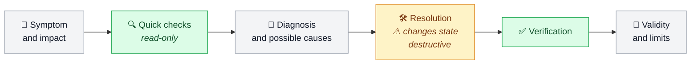
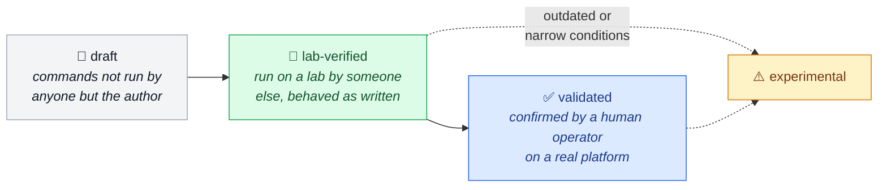

[← OzarLand home](https://github.com/OzarLand/ozarland)

# 🔧 openstack-vm-runbooks

**Community runbooks for diagnosing and resolving virtual machine problems in OpenStack.**

<!-- status-badges:start -->
  
  
  
  
<!-- status-badges:end -->
  
  

  <a href="#-start-from-what-you-see"><b>Start from a symptom</b></a> ·
  <a href="#index"><b>Index</b></a> ·
  <a href="#-how-much-each-page-was-checked"><b>Status</b></a> ·
  <a href="#-contributing"><b>Contribute</b></a>

---

Part of [OzarLand](https://github.com/OzarLand/ozarland): *a shared land for better OpenStack operations.* No imposed
tools, no single way of operating OpenStack.

- 🧪 Practise these runbooks on a disposable lab with
  [openstack-quick-lab](https://github.com/OzarLand/openstack-quick-lab).
- 🤖 The [openstack-operator-skills](https://github.com/OzarLand/openstack-operator-skills) Claude skills draw on
  them and keep their status attached. A correction belongs here first.

## 🧭 How a runbook works

Each runbook follows the shared [runbook structure](https://github.com/OzarLand/ozarland/blob/main/docs/conventions/runbook-structure.md):

State-changing commands carry ⚠️, destructive ones carry 🛑 with what can be lost and what to check first.

## 🎯 Scope

Everything an operator does when an instance misbehaves, from the first symptom to the post-fix checks.

| ✅ In scope | ❌ Out of scope |
|---|---|
| Instances stuck in an unexpected state (`BUILD`, `deleting`, `resizing`, `migrating`, `ERROR`, `SHUTOFF` when it should run, task states that never clear) | Deploying OpenStack: see [kolla-ansible-deployment-patterns](https://github.com/OzarLand/kolla-ansible-deployment-patterns) |
| Boot and scheduling failures: `No valid host`, Placement allocation problems, image or flavor issues, boot from volume failures, console not available | Upgrade campaigns: planned for a future `openstack-upgrade-playbooks` repository |
| Create, delete and migration errors: live and cold migration, resize, evacuation. Shelve and unshelve: no page yet, [wanted](https://github.com/OzarLand/openstack-vm-runbooks/issues/new?template=problem-solved.yml) | Storage-backend-only problems |
| Instance networking: no DHCP lease, no metadata, no floating IP connectivity, security group surprises, MTU symptoms as seen from the instance, port binding failures | Control-plane failures (database, message queue, load balancer, Keystone), except where they affect instances: see `recovery/` and `logs/` |
| Volumes: attach and detach failures, stale attachments, volumes stuck `attaching`/`detaching`/`in-use`, boot volume problems. Multi-attach: no page yet, [wanted](https://github.com/OzarLand/openstack-vm-runbooks/issues/new?template=problem-solved.yml) | |
| Diagnostics across Nova, Neutron, Glance, Cinder and Placement with the OpenStack CLI, service logs and the hypervisor (libvirt, QEMU) | |
| Recovery after an incident (compute node loss, control plane outage) as it affects instances, and the verifications to run afterwards. Storage outage: no page yet, [wanted](https://github.com/OzarLand/openstack-vm-runbooks/issues/new?template=problem-solved.yml) | |

## 🗂️ How content is organised

| Folder | What it holds |
|---|---|
| 🔄 `lifecycle/` | Stuck states, create, delete, resize |
| 📅 `scheduling/` | No valid host, Placement, flavors, images, boot from volume |
| 🚚 `migration/` | Live and cold migration, moving instances off a host for maintenance |
| 🌐 `networking/` | Instance connectivity, DHCP, metadata, floating IPs, security groups, port binding |
| 💾 `volumes/` | Attach, detach, stale attachments, boot volumes |
| 🩺 `diagnostics/` | Cross-cutting investigations: what a request traverses, platform-wide failures, clock skew |
| 📜 `logs/` | Where the logs are and how to read them: services, infrastructure, hypervisor (see [logs/README.md](logs/README.md)) |
| 🚑 `recovery/` | After a compute, storage or control plane incident, evacuation; post-incident checks |
| 📄 `templates/` | Runbook template |

A page written for one deployment method is welcome; variants for other methods are added by whoever has them.

## 🔬 How much each page was checked

A runbook's `status` says how much it has been verified (see the
[knowledge lifecycle](https://github.com/OzarLand/ozarland/blob/main/docs/knowledge-lifecycle.md)):

<b>The four statuses, word for word</b>

| Status | What it means |
|---|---|
| `draft` | Written; its commands have not been run by anyone other than the author. |
| `lab-verified` | Its commands were run on a lab by someone other than the author, on the release stated in the page, and behaved as the page says. |
| `validated` | Confirmed by a human operator, other than the author, on a real platform. |
| `experimental` | Possibly outdated, or confirmed only under narrow conditions. |

<!-- status-progress:start -->
**Where things stand:** 72 pages, 44 `lab-verified`, 28 `draft`, none `validated` or `experimental`.

| Folder | Progress | Lab-verified or validated |
|---|---|---:|
| 🔄 Lifecycle | 🟩🟩🟩🟩🟩🟩🟩🟩⬜⬜ | 8 / 10 |
| 📅 Scheduling | 🟩🟩🟩🟩🟩🟩🟩🟩🟩⬜ | 6 / 7 |
| 🚚 Migration | 🟩🟩🟩🟩🟩🟩🟩⬜⬜⬜ | 2 / 3 |
| 🌐 Networking | 🟩🟩🟩🟩🟩🟩🟩🟩⬜⬜ | 7 / 9 |
| 💾 Volumes | 🟩🟩🟩🟩🟩🟩🟩🟩⬜⬜ | 4 / 5 |
| 🩺 Diagnostics | 🟩🟩🟩🟩🟩🟩⬜⬜⬜⬜ | 3 / 5 |
| 📜 Logs | 🟩🟩⬜⬜⬜⬜⬜⬜⬜⬜ | 5 / 22 |
| 🚑 Recovery | 🟩🟩🟩🟩🟩🟩🟩🟩⬜⬜ | 9 / 11 |

🟩 lab-verified · ⬜ draft · one square is about 10 % of the folder's pages
<!-- status-progress:end -->
> [!WARNING]
> Nothing here has been confirmed on a production platform by an operator other than the author. Lab verification
> so far was done by OzarLand's AI lab agent, on OpenStack 2026.1 deployed with Kolla-Ansible 22.2.0 (all-in-one,
> 1 controller and 2 computes, or 3 controllers and 2 computes), mostly with ML2/OVS; OVN, Ceph and other deployment tools are largely untested.
> A `lab-verified` page can still contain steps that were not run: its `confirmed_by` note and its *Validity and
> limits* section say which. Read every page as a well-documented lead, not as a proven procedure, and read its
> read-only checks before any ⚠️ or 🛑 step.

## 🚦 Start from what you see

| You see | Start with |
|---|---|
| Every instance on one compute lost the network, Nova still shows them ACTIVE | [ovs-vswitchd down](networking/ovs-vswitchd-down-on-compute.md), then [tunnel MTU mismatch](networking/tunnel-mtu-mismatch-large-packets-dropped.md) |
| Instances answer ping, but large transfers stall | [Tunnel MTU mismatch](networking/tunnel-mtu-mismatch-large-packets-dropped.md) |
| A snapshot stays in `image_uploading`, its image `queued` or `saving` | [Snapshot never finishes](lifecycle/snapshot-stuck-in-image-uploading.md) |
| Every API call fails at once | [Expired certificates or Fernet keys](diagnostics/expired-certificates-and-fernet-keys-break-every-api-call.md) |
| An API answers 503 "No server is available to handle this request", or the VIP moves between nodes | [API 503, backend DOWN, VIP flapping](recovery/api-returns-503-haproxy-backend-down-or-vip-flapping.md) |
| Every API fails, the logs show database errors (`WSREP has not yet prepared node`) | [Galera lost quorum](recovery/galera-cluster-lost-quorum-database-unavailable.md) |
| VM creation fails everywhere, running instances are fine | [Check the shared dependencies first](diagnostics/vm-creation-fails-platform-wide-check-shared-dependencies.md) |
| `openstack token issue` works, but service calls fail with 401 for some tokens, often every other time | [401 with a fresh token: Fernet keys or clock](recovery/keystone-401-for-every-request-fernet-keys-or-clock.md) |
| A new instance is ACTIVE but never got an IP address | [DHCP agents down](networking/new-instance-gets-no-ip-dhcp-agents-down.md) |
| A new instance has an address but no SSH key, default hostname | [Metadata agents down](networking/new-instance-boots-without-metadata.md) |
| A build or live migration fails with "Binding failed for port" | [Port binding failed](networking/port-binding-failed.md) |
| A security group rule changes nothing: allowed traffic still blocked, or blocked traffic still passing | [Security group rules not applied](networking/security-group-rules-not-applied.md) |
| An instance answers from inside its network, not from outside | [Unreachable from outside](networking/instance-unreachable-from-outside.md) |
| The console of an instance does not open, or fails at once | [Console not available](lifecycle/console-not-available-or-disconnects.md) |
| An instance stays in BUILD, then ERROR after about 5 minutes | [Waiting for vif_plugged](lifecycle/instance-stuck-in-build-waiting-for-vif-plugged.md) |
| A resize stays in VERIFY_RESIZE or RESIZE, or ends in ERROR | [Resize not finished](lifecycle/resize-stuck-in-verify-resize-or-failed.md) |
| "No valid host was found" while computes have room | [No valid host with free capacity](scheduling/no-valid-host-with-free-capacity.md) |
| An instance stays in `deleting`, and deleting it again does nothing | [Stuck in deleting](lifecycle/instance-stuck-in-deleting.md) |
| A new instance is ERROR with "Exceeded maximum number of retries" | [The real error is on the computes that tried](scheduling/build-fails-exceeded-maximum-number-of-retries.md) |
| Placement usage of a compute does not match its instances, or a resource provider cannot be deleted (HTTP 409) | [Placement allocations out of sync](scheduling/placement-allocations-out-of-sync-audit-and-heal.md) |
| The guest does not boot (kernel panic, emergency shell) or is unreachable after a change inside it | [Rescue mode](lifecycle/rescue-mode-repair-an-unbootable-guest.md) |
| nova-compute says "Possible rename detected, refusing to start!", or logs "Conflicting resource provider name" | [Compute renamed or re-added](scheduling/compute-renamed-or-re-registered-resource-provider-conflict.md) |
| A boot is refused or aborted: "Flavor's disk is too small for requested image" | [Image larger than the flavor's disk](scheduling/image-larger-than-flavor-disk.md) |
| A boot from volume ends in ERROR ("Failure prepping block device"), or boots nothing | [Instance fails to boot from volume](scheduling/instance-fails-to-boot-from-volume.md) |
| An instance went SHUTOFF on its own, Nova logged "shutdown by itself" | [Host OOM killer](lifecycle/instance-shut-off-by-host-oom-killer.md) |
| An attached volume was extended, but the instance still sees the old size (or the extend failed) | [Extending an attached volume](volumes/extend-in-use-volume-guest-sees-old-size.md) |
| After a compute reboot, instances stay SHUTOFF or have no network | [After a compute reboot](recovery/after-a-compute-reboot-instances-shutoff-or-without-network.md) |
| A volume stays in `deleting` or `error_deleting`, or comes back `available` after a delete | [Volume stuck in deleting](volumes/volume-stuck-in-deleting-or-error-deleting.md) |
| A compute is unreachable and its instances are down | [Fence before you evacuate](recovery/compute-host-failure-fence-before-evacuate.md) |
| `MessagingTimeout` in every service, computes reported down while they run | [RabbitMQ partitioned or blocked](recovery/rabbitmq-partition-or-alarm-rpc-timeouts.md) |

## Index

Click a category to open it. Source: **book** (*OpenStack, the Day After Tomorrow*, the maintainer's book), **lab run** (observed on a
lab), **documentation** (upstream documentation and source), **production incident**.

<b>🔄 Lifecycle</b>

| Page | Components | Releases | Status | Source |
|---|---|---|---|---|
| [Instance console (noVNC or SPICE) does not open, fails at once, or shows "invalid or has expired"](lifecycle/console-not-available-or-disconnects.md) | nova, libvirt, haproxy, horizon | 2026.1 | draft | documentation |
| [Compute disk full. An instance that writes is frozen, while Nova still shows it ACTIVE](lifecycle/compute-disk-full-instance-paused.md) | nova, libvirt, qemu | 2026.1 | lab-verified | lab run |
| [Instance stuck in BUILD, then ERROR after vif_plugging_timeout](lifecycle/instance-stuck-in-build-waiting-for-vif-plugged.md) | nova, neutron, ovn, ovs | 2026.1 | lab-verified | book, lab run |
| [Instance goes SHUTOFF by itself, nobody stopped it. The compute's OOM killer killed its QEMU process](lifecycle/instance-shut-off-by-host-oom-killer.md) | nova, libvirt, qemu, placement, linux-kernel | 2026.1 | draft | documentation |
| [Instance stuck in deleting, or in ERROR after a delete. Deleting it again does nothing](lifecycle/instance-stuck-in-deleting.md) | nova, libvirt, cinder, neutron, placement | 2026.1 | lab-verified | documentation, lab run |
| [I need to restart nova_libvirt on a compute. Its instances keep running](lifecycle/restarting-nova-libvirt-does-not-stop-instances.md) | nova, libvirt | 2026.1 | lab-verified | lab run |
| [Resize or cold migration not finished. Instance in VERIFY_RESIZE, stuck in RESIZE, or in ERROR after a failed resize](lifecycle/resize-stuck-in-verify-resize-or-failed.md) | nova, placement, libvirt | 2026.1 | lab-verified | documentation, lab run |
| [The guest does not boot or cannot be reached (broken fstab, kernel, network or SSH configuration). Repair its disk in rescue mode](lifecycle/rescue-mode-repair-an-unbootable-guest.md) | nova, libvirt, glance | 2026.1 | lab-verified | documentation, lab run |
| [Stale records. Instances stuck in BUILD, ERROR or deleting, orphan ports and attachments, phantom allocations](lifecycle/stale-records-stuck-instances-orphan-ports-attachments.md) | nova, placement, neutron, cinder, mariadb | 2026.1 | lab-verified | book, lab run |
| [Instance snapshot never finishes. Task state image_pending_upload or image_uploading, image queued or saving](lifecycle/snapshot-stuck-in-image-uploading.md) | nova, glance, libvirt, ceph | 2026.1 | lab-verified | documentation, lab run |

<b>📅 Scheduling</b>

| Page | Components | Releases | Status | Source |
|---|---|---|---|---|
| [New instance in ERROR with "Exceeded maximum number of retries". The real error is on the computes that tried](scheduling/build-fails-exceeded-maximum-number-of-retries.md) | nova, placement | 2026.1 | lab-verified | documentation, lab run |
| [Boot refused or aborted because the flavor's disk is too small for the image](scheduling/image-larger-than-flavor-disk.md) | nova, glance, cinder | 2026.1 | lab-verified | documentation, lab run |
| [Instance fails to boot from volume. ERROR at build, or ACTIVE with no bootable disk](scheduling/instance-fails-to-boot-from-volume.md) | nova, cinder, glance, libvirt | 2026.1 | lab-verified | documentation, lab run |
| [No valid host was found, although capacity exists](scheduling/no-valid-host-with-free-capacity.md) | nova, placement | 2026.1 | lab-verified | book, lab run |
| [A compute shows disabled or down. Why, what still works on it, and how to bring it back](scheduling/compute-service-disabled-or-forced-down.md) | nova, placement, libvirt | 2026.1 | lab-verified | documentation, lab run |
| [A compute was renamed, reinstalled or re-added. nova-compute refuses to start, or gets no resource provider](scheduling/compute-renamed-or-re-registered-resource-provider-conflict.md) | nova, placement | 2026.1 | draft | documentation |
| [Placement allocations do not match the instances. Compute looks full or empty, audit and heal](scheduling/placement-allocations-out-of-sync-audit-and-heal.md) | nova, placement | 2026.1 | lab-verified | documentation, lab run |

<b>🚚 Migration</b>

| Page | Components | Releases | Status | Source |
|---|---|---|---|---|
| [CPU steal time on instances with dedicated (pinned) CPUs. Live migration moves the symptom, not the cause](migration/cpu-steal-on-pinned-instances.md) | nova, libvirt, qemu | 2026.1 | lab-verified | book, lab run |
| [Live migration runs for a long time, then is aborted. The instance writes memory faster than it can be copied](migration/live-migration-never-completes-or-times-out.md) | nova, libvirt, qemu | 2026.1 | draft | documentation |
| [Moving instances off a compute host for planned maintenance (patching, reboot, hardware)](migration/moving-instances-off-a-host-for-maintenance.md) | nova, libvirt, qemu | 2026.1 | lab-verified | book, lab run |

<b>🌐 Networking</b>

| Page | Components | Releases | Status | Source |
|---|---|---|---|---|
| [Instance has its address and metadata, but is unreachable from outside](networking/instance-unreachable-from-outside.md) | neutron, nova, ovs, ovn | 2026.1 | lab-verified | documentation, lab run |
| [New instance has an address, but no SSH key, no user data, default hostname](networking/new-instance-boots-without-metadata.md) | neutron, nova | 2026.1 | lab-verified | lab run |
| [Instance build or live migration fails with "Binding failed for port". Neutron could not bind the port on that host](networking/port-binding-failed.md) | neutron, nova, ovs, ovn | 2026.1 | draft | documentation |
| [New instance is ACTIVE but unreachable, it never got an IP address](networking/new-instance-gets-no-ip-dhcp-agents-down.md) | neutron, nova | 2026.1 | lab-verified | lab run |
| [Every instance on one compute loses the network while Nova shows them ACTIVE (ovs-vswitchd down)](networking/ovs-vswitchd-down-on-compute.md) | neutron, ovs | 2026.1 | lab-verified | lab run |
| [I need to restart the Open vSwitch agent on a compute. Its instances keep their network](networking/restarting-the-ovs-agent-does-not-cut-instances.md) | neutron, ovs | 2026.1 | lab-verified | lab run |
| [L3 agent dead, instances still reachable, router not moved](networking/router-stuck-on-dead-l3-agent.md) | neutron | 2026.1 | lab-verified | lab run |
| [A security group rule has no effect. Traffic it allows is still blocked, or traffic it should block still passes](networking/security-group-rules-not-applied.md) | neutron, ovs, ovn, iptables | 2026.1 | draft | documentation |
| [Instances of one compute answer ping, but large transfers stall](networking/tunnel-mtu-mismatch-large-packets-dropped.md) | neutron, ovs | 2026.1 | lab-verified | lab run |

<b>💾 Volumes</b>

| Page | Components | Releases | Status | Source |
|---|---|---|---|---|
| [Extending an attached volume. Refused, error_extending, or the instance still sees the old size](volumes/extend-in-use-volume-guest-sees-old-size.md) | cinder, nova, libvirt, os-brick | 2026.1 | draft | documentation |
| [Stale volume attachment. The volume is still in-use for an instance that was deleted or evacuated](volumes/stale-volume-attachment-after-instance-deleted-or-evacuated.md) | cinder, nova, libvirt | 2026.1 | lab-verified | documentation, lab run |
| [Volume stuck in attaching, reserved or detaching. The attach or detach never finishes](volumes/volume-stuck-in-attaching-or-detaching.md) | cinder, nova, libvirt | 2026.1 | lab-verified | documentation, lab run |
| [Volume stuck in creating, or in error right after create](volumes/volume-stuck-in-creating-or-error-after-create.md) | cinder, glance, rabbitmq | 2026.1 | lab-verified | documentation, lab run |
| [Volume stuck in deleting, in error_deleting, or back to available after a delete](volumes/volume-stuck-in-deleting-or-error-deleting.md) | cinder, ceph, rabbitmq | 2026.1 | lab-verified | documentation, lab run |

<b>🩺 Diagnostics</b>

| Page | Components | Releases | Status | Source |
|---|---|---|---|---|
| [The logs of one compute do not line up with the controllers. Its clock has drifted](diagnostics/compute-clock-skew.md) | nova, neutron, ntp | 2026.1 | lab-verified | lab run |
| [Control plane down. What still works for running instances, and what does not](diagnostics/control-plane-down-what-still-works-for-instances.md) | nova, neutron, ovn, ovs, libvirt | 2026.1 | lab-verified | book, lab run |
| [Every API call fails at once. Expired TLS certificates or inconsistent Keystone Fernet keys](diagnostics/expired-certificates-and-fernet-keys-break-every-api-call.md) | keystone, haproxy, rabbitmq, mariadb, memcached | 2026.1 | draft | book |
| [VM creation fails platform-wide while instances keep running. Check the shared dependencies first](diagnostics/vm-creation-fails-platform-wide-check-shared-dependencies.md) | nova, neutron, rabbitmq, mariadb, memcached, haproxy, keystone | 2026.1 | draft | book |
| [What a VM creation traverses, and how to trace one failed boot by request id](diagnostics/what-a-vm-creation-traverses-and-tracing-by-request-id.md) | nova, placement, neutron, glance, cinder, keystone, rabbitmq | 2026.1 | lab-verified | book, lab run |

<b>📜 Logs</b>

| Page | Components | Releases | Status | Source |
|---|---|---|---|---|
| [Where the OpenStack logs are, and how to read one log line](logs/where-openstack-logs-are-and-how-to-read-a-line.md) | nova, neutron, placement, keystone, glance, cinder, rabbitmq, mariadb, haproxy, ovs, ovn, libvirt | 2026.1 | lab-verified | documentation, lab run |
| [Reading the Keystone logs, and the authentication lines every service writes (401, 503, Fernet)](logs/reading-keystone-and-auth-logs.md) | keystone, memcached, nova, neutron | 2026.1 | draft | documentation |
| [Reading the Cinder logs. cinder-api, cinder-scheduler, cinder-volume, and os-brick on the compute](logs/reading-cinder-logs.md) | cinder, nova | 2026.1 | draft | documentation |
| [Following one request, instance, port or volume through the logs of every service and host](logs/tracing-one-request-across-services-and-hosts.md) | nova, neutron, placement, cinder, glance, ovs, libvirt | 2026.1 | draft | documentation |
| [Reading the MariaDB and Galera logs, and the oslo.db lines that go with them](logs/reading-mariadb-galera-logs.md) | mariadb, proxysql, haproxy, nova, neutron, keystone | 2026.1 | lab-verified | documentation, lab run |
| [Reading the Glance logs, and the image lines in Nova's logs (boot, snapshot)](logs/reading-glance-logs.md) | glance, nova | 2026.1 | draft | documentation |
| [Reading the Nova logs. What normal looks like, and what the common lines mean](logs/reading-nova-logs.md) | nova, placement, rabbitmq, libvirt | 2026.1 | draft | documentation |
| [Reading the HAProxy, keepalived and memcached logs in front of the OpenStack APIs](logs/reading-haproxy-keepalived-memcached-logs.md) | haproxy, keepalived, proxysql, memcached, keystone | 2026.1 | lab-verified | documentation, lab run |
| [Reading the Octavia logs. Health manager, amphora heartbeats, failovers and the worker](logs/reading-octavia-logs.md) | octavia, nova, neutron | 2026.1 | draft | documentation |
| [Reading the RabbitMQ logs, and the oslo.messaging lines that go with them](logs/reading-rabbitmq-logs.md) | rabbitmq, nova, neutron, cinder | 2026.1 | lab-verified | documentation, lab run |
| [Reading the Placement logs, and the Placement lines in Nova's logs](logs/reading-placement-logs.md) | placement, nova | 2026.1 | draft | documentation |
| [Reading the Heat logs. From a failed stack to the service that really failed](logs/reading-heat-logs.md) | heat, nova, neutron, cinder | 2026.1 | draft | documentation |
| [Reading the Neutron logs with ML2/OVS](logs/reading-neutron-logs-ml2-ovs.md) | neutron, ovs, nova, rabbitmq | 2026.1 | draft | documentation |
| [Reading the OVN logs with Neutron](logs/reading-ovn-logs.md) | ovn, neutron, ovs | 2026.1 | draft | documentation |
| [Error messages: messaging and database. MessagingTimeout, AMQP connection and heartbeat lines, DBConnectionError](logs/error-messages-messaging-and-database.md) | rabbitmq, mariadb, proxysql, haproxy, nova, neutron, cinder | 2026.1 | draft | documentation |
| [Error messages: scheduling. No valid host was found, Exceeded maximum number of retries](logs/error-messages-scheduling.md) | nova, placement | 2026.1 | draft | documentation |
| [Reading the storage logs of a compute. iscsid, multipathd, NFS client messages and Ceph client (librbd) logs](logs/host-storage-logs-iscsi-multipath-nfs-rbd.md) | nova, cinder, iscsi, multipath, nfs, ceph | 2026.1 | draft | documentation |
| [Reading the kernel log of a compute (dmesg, journalctl -k). OOM killer, KVM, links and bonds, MTU, disks, conntrack, hung tasks](logs/kernel-messages-on-computes.md) | nova, libvirt, qemu, ovs, linux | 2026.1 | draft | documentation |
| [Reading the libvirt and QEMU logs of a compute, and the guest console log](logs/libvirt-and-qemu-logs.md) | nova, libvirt, qemu | 2026.1 | draft | documentation |
| [Reading the Open vSwitch logs (ovs-vswitchd, ovsdb-server) and changing their levels with ovs-appctl](logs/open-vswitch-logs.md) | ovs, neutron | 2026.1 | draft | documentation |
| [Reading the systemd journal and the container engine on an OpenStack host. Units, priorities, time ranges, restart loops](logs/systemd-journal-and-container-engine.md) | systemd, docker, podman, nova, neutron | 2026.1 | lab-verified | documentation, lab run |
| [Reading the time synchronisation logs (chrony, systemd-timesyncd), and how clock skew shows in OpenStack logs](logs/time-sync-chrony-and-clock-skew.md) | chrony, systemd, nova, neutron, keystone | 2026.1 | draft | documentation |

<b>🚑 Recovery</b>

| Page | Components | Releases | Status | Source |
|---|---|---|---|---|
| [After a compute reboot, instances stay SHUTOFF or come back without network](recovery/after-a-compute-reboot-instances-shutoff-or-without-network.md) | nova, neutron, ovs, libvirt | 2026.1 | lab-verified | documentation, lab run |
| [The API returns 503, an HAProxy backend is DOWN, or the VIP flaps or sits on two nodes](recovery/api-returns-503-haproxy-backend-down-or-vip-flapping.md) | haproxy, keepalived, keystone, nova, neutron | 2026.1 | lab-verified | documentation, lab run |
| [Compute host unreachable, instances down. Fence before you evacuate](recovery/compute-host-failure-fence-before-evacuate.md) | nova, libvirt, cinder, ceph | 2026.1 | lab-verified | book, lab run |
| [Requests fail with 401 for tokens that should be valid. Fernet keys differ between Keystone nodes, or a clock is off](recovery/keystone-401-for-every-request-fernet-keys-or-clock.md) | keystone, nova, neutron | 2026.1 | lab-verified | documentation, lab run |
| [Services fail on "Too many connections", "Max connect timeout" or "QueuePool limit". Database connections are exhausted](recovery/database-too-many-connections-or-pool-exhausted.md) | mariadb, proxysql, nova, neutron, keystone | 2026.1 | draft | documentation |
| [Every API fails on database errors. The Galera cluster lost quorum, or stopped on every node](recovery/galera-cluster-lost-quorum-database-unavailable.md) | mariadb, galera, kolla-ansible, nova, neutron, keystone | 2026.1 | lab-verified | documentation, lab run |
| [nova-compute is down and the compute refuses an SSH login, but the host is alive](recovery/nova-compute-down-host-alive-ssh-refused.md) | nova, libvirt, ssh | 2026.1 | lab-verified | lab run |
| [nova-compute is down on a compute, but its instances are still running](recovery/nova-compute-down-instances-still-running.md) | nova, libvirt | 2026.1 | lab-verified | lab run |
| [RPC timeouts in every service, computes reported down. RabbitMQ is partitioned, blocked by an alarm, or a node is missing](recovery/rabbitmq-partition-or-alarm-rpc-timeouts.md) | rabbitmq, oslo.messaging, kolla-ansible, nova, neutron, cinder | 2026.1 | lab-verified | documentation, lab run |
| [nova-conductor or nova-scheduler is down. What still works, what waits, what fails, and where failed builds go (cell0)](recovery/nova-conductor-or-scheduler-down-what-still-works.md) | nova, rabbitmq | 2026.1 | lab-verified | documentation, lab run |
| [Reopening provisioning after a control-plane incident. Stop the APIs, recover, verify, reopen](recovery/reopening-provisioning-after-control-plane-incident.md) | nova, neutron, rabbitmq, mariadb, haproxy | 2026.1 | draft | book |

## 📝 Pages wanted next

Candidate runbooks that almost every operator has met and that are not written yet. Each needs a real occurrence
behind it; open a *Problem solved* issue if you have one.

1. Live migration fails: pre-check errors, shared storage assumptions, CPU model mismatch.
2. Floating IP does not answer with ML2/OVN (the ML2/OVS case is in
   [instance unreachable from outside](networking/instance-unreachable-from-outside.md)).
3. Shelve and unshelve: instance stuck in `SHELVED_OFFLOADED`, unshelve fails or lands without its network.
4. Multi-attach volumes: attach refused, or a second instance does not see the volume.
5. Storage outage: what happens to running instances when the volume or image backend goes away, and how to
   recover them afterwards.

## 🤝 Contributing

| | How |
|:-:|---|
| 💬 | **Ask a question:** [open a Q&A discussion](https://github.com/OzarLand/ozarland/discussions/new?category=q-a) in `ozarland`, where all OzarLand discussions live |
| 🛠️ | **Share a problem you solved:** open an issue with the [*Problem solved* form](https://github.com/OzarLand/openstack-vm-runbooks/issues/new?template=problem-solved.yml), or a pull request with a runbook |
| ✅ | **Confirm a runbook in your environment:** open a [*Documentation proposal* issue](https://github.com/OzarLand/openstack-vm-runbooks/issues/new?template=documentation-proposal.yml) and choose "I confirmed an existing page in my environment". This is how runbooks become validated |
| ✍️ | **Add or improve a runbook:** copy `templates/runbook.md`, open a pull request |

> [!IMPORTANT]
> Rules that are not optional: no secrets, hostnames, addresses or unredacted logs; flag state-changing and
> destructive commands; say where your solution was observed. Full guide: [CONTRIBUTING.md](CONTRIBUTING.md).

## 🌍 Part of OzarLand

**OzarLand: a shared land for better OpenStack operations.** It started as a personal initiative by Soufian Zaouam
to share practical OpenStack operational knowledge, and it is meant to grow into a space where operators exchange
experience, document solutions and help each other run more reliable platforms. It is open to everyone: your
knowledge, questions and corrections are welcome.

| | Repository | What it holds |
|:-:|---|---|
| | [ozarland](https://github.com/OzarLand/ozarland) | Start here: newcomer path, community rules, [Discussions](https://github.com/OzarLand/ozarland/discussions) |
| 🔧 | `openstack-vm-runbooks` **(you are here)** | Symptom-driven runbooks for instance problems |
| 🏗️ | [kolla-ansible-deployment-patterns](https://github.com/OzarLand/kolla-ansible-deployment-patterns) | Ways to deploy with Kolla-Ansible, compared |
| 🧪 | [openstack-quick-lab](https://github.com/OzarLand/openstack-quick-lab) | A disposable OpenStack lab to practise on |
| 🤖 | [openstack-operator-skills](https://github.com/OzarLand/openstack-operator-skills) | Claude skills that apply this knowledge |

## ⚖️ License

All content, documentation and code alike, is licensed under the Apache License 2.0 ([LICENSE](LICENSE)). Reuse it
freely with attribution. See [licensing](https://github.com/OzarLand/ozarland/blob/main/docs/conventions/licensing.md).

OpenStack is a project of the OpenInfra Foundation community. OzarLand is an independent community initiative.
